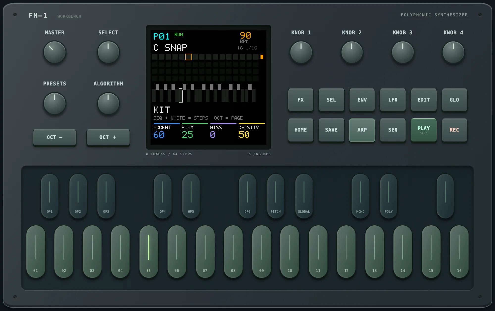
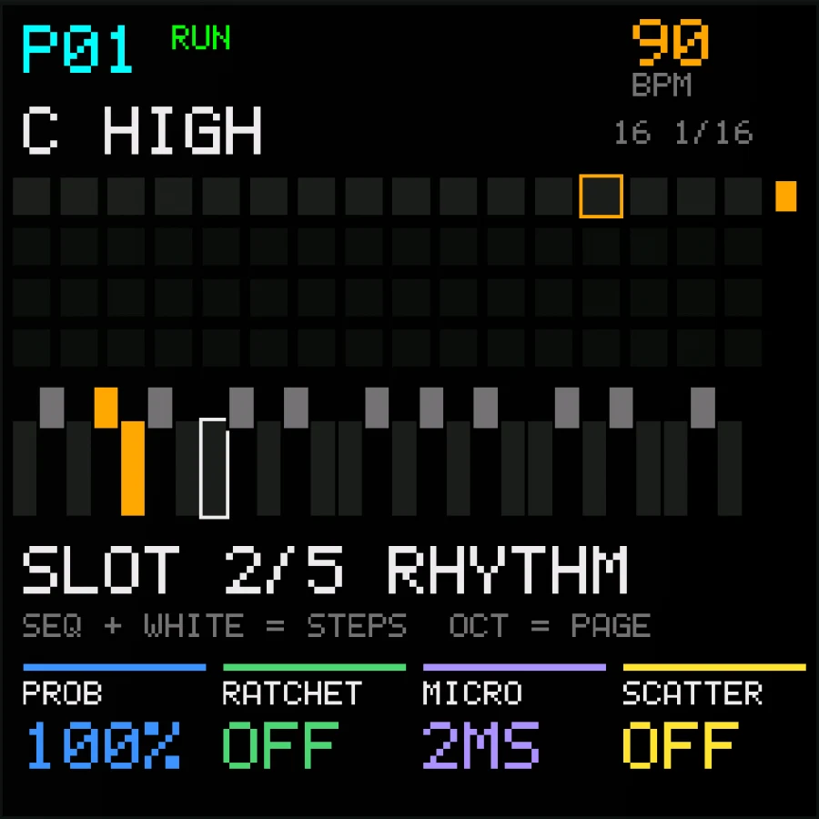
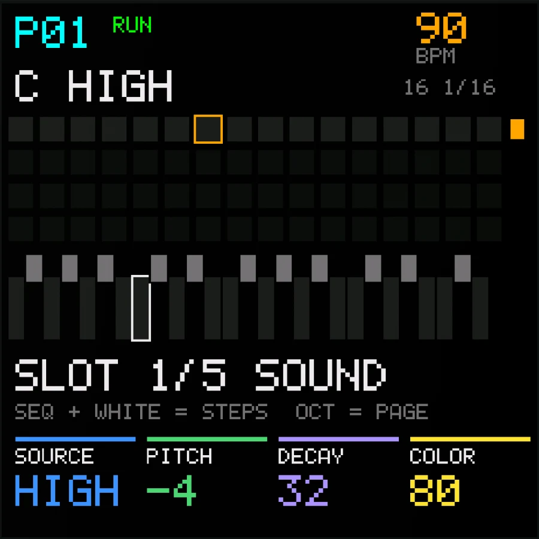
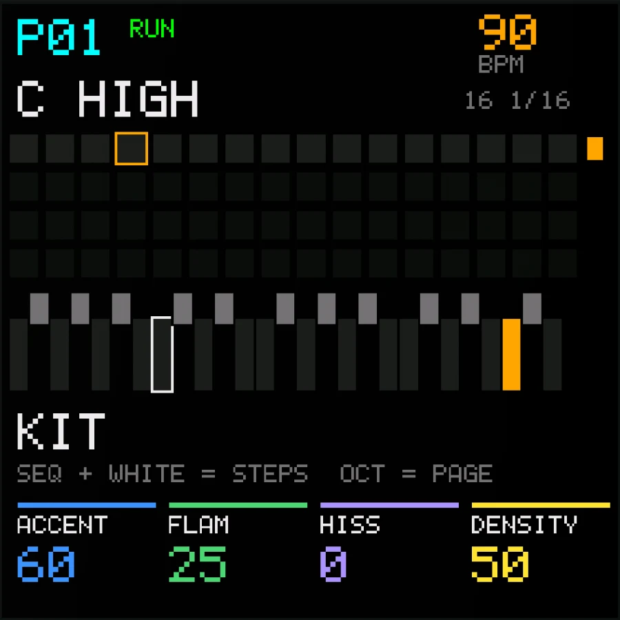

# GLITCH – microsound drum machine for the M-VAVE FM-1

GLITCH is a custom firmware for the **M-VAVE FM-1**. It turns the FM-1 into a
drum machine for fine glitch and microsound beats: every sound is
synthesized (clicks, click trains, digital crunch, noise snaps, micro kicks,
speaker pops, too-short loops, very high beeps …), loops can live and mutate
from bar to bar, and stutter, ratchet and reverse effects are on the keys.

<p align="center"></p>

<p align="center">  </p>

<p align="center"><b><a href="https://subcity.at/flash/fm1-glitch-drums/">Install in the browser</a></b> · <a href="https://subcity.at/demo/fm1-glitch-drums/">Try the simulator</a> · <a href="https://subcity.at/fm1-glitch-drums/">Downloads &amp; guide</a></p>

> **Beta – a hobby project.** GLITCH runs on a real FM-1: the first hardware
> test (October 2026) showed a CPU load **below 30 %** with dense beats and
> effects, and the sound comes across as in the simulator. It has been tried
> on one unit so far, so test reports from more FM-1 owners are very welcome
> (see below). No support is promised.

Built on [M-VAVE FM1 Open](https://github.com/m-vave/fm1_open) (V14); the
original README is kept in [README.fm1-open.md](README.fm1-open.md).

## What it does

- **27 slots, one per key:** A is a classic hi-hat, the other 26 play
  synthesized microsounds with PITCH, DECAY, COLOR and RANDOM per hit.
- **Polymetric step sequencer:** up to 64 steps per slot, own length and rate
  (1/16 – 1/64), probability, ratchets per slot and per step, micro timing,
  scatter, ACCENT and FLAM (hits that come twice between the steps).
- **Random beats** in the style of abstract glitch (micro kick, snare, hat as
  the frame, quiet glitch layers around it) and **living loops** (MUTATE).
- **Momentary effects:** hold FX + a white key for 16 stutter/repeat effects,
  FX + a black key for 11 punch-in effects (ratchet, roll, reverse, scratch,
  shuffle, chaos …).
- **Space:** tape echo, delay, filter with drive, shimmer reverb; hard and
  occasional 100/0 panning.
- **16 patterns** stored on the device, MIDI notes, clock, start and stop.

The full manual is [GLITCH.md](GLITCH.md).

## Install

**In the browser:** open [subcity.at/flash/fm1-glitch-drums](https://subcity.at/flash/fm1-glitch-drums/) in Chrome or
Edge, connect the FM-1 by USB and use *Device update* (coming from the stock firmware:
*Recovery & force update*). The page also holds the original M-VAVE V15 firmware to go back.
The same page is in the download on [subcity.at/fm1-glitch-drums](https://subcity.at/fm1-glitch-drums/) and in the [latest release](../../releases).

**Before flashing:** back up your projects, voices and samples with the
firmware that is on the device now. GLITCH stores its patterns in the sample
area and cannot read FM1 projects, voices or samples.

With FM1 Open firmware already on the device, macOS users can also flash from
the command line: `python3 tools/flash_fm1.py flash` (see GLITCH.md).

## Build

macOS: see *Building on macOS* in [GLITCH.md](GLITCH.md) (JieLi toolchain
under Wine, WASI SDK for the browser simulator). Tests:

```
tests/run_native.sh              # DSP tests
node tests/glitch_sim_test.mjs   # simulator: every function, writes a demo WAV
python3 tests/flash_fm1_test.py  # command-line flasher against a simulated FM-1
```

## Test reports and contributions

The biggest help is a test on a real FM-1. Please open an issue with the
**Hardware test report** template: firmware build, what you played, the CPU
figure on the HOME page, and anything that crackled, hung or sounded wrong.

Bug reports, ideas and pull requests are welcome and will be looked at when
there is time. Only the maintainer decides what goes into official releases;
forks under their own name are fine (GPL). Details: [CONTRIBUTING.md](CONTRIBUTING.md).

## License

The firmware sources are GPL-3.0-only with the FM1 linking exception
([LICENSE.md](LICENSE.md)). The FM1 binary SDK, boot files and the V15
recovery image keep their own terms ([THIRD_PARTY.md](THIRD_PARTY.md)).
GLITCH is not an M-VAVE product and comes without warranty; flashing is at
your own risk.
